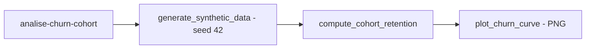

# analise-churn-cohort

**English** · [Português (Brasil)](README.md)

[](#) [](#) [](#) [](#) [](LICENSE)

## What it is

**Churn analysis with retention cohorts**: it generates synthetic data (users + purchases, fixed seed), computes **per-cohort retention** (period × cohort) and plots the **churn curve** (matplotlib). It is an educational data-analysis lab for understanding customer retention.

## Status

An educational analysis lab, working and tested (11 tests).

## Features

- **Deterministic synthetic data** (`generate_synthetic_data`, fixed seed 42).
- **Per-cohort retention** (`compute_cohort_retention`): a cohort × period matrix.
- **Churn curve** (`plot_churn_curve`): saves a PNG with the retention trend.
- **CLI** `analise-churn-cohort`: `--n-users` (1000), `--n-purchases` (5000), `--output-dir`, `--seed` (42).

## Architecture

An `analise_churn_cohort` package with `cohort.py` (calculation/plotting), `cli.py` (interface) and `__main__.py`. Synthetic data → retention → PNG.



## Stack

- Python ≥ 3.10
- pandas ≥ 2.0, matplotlib ≥ 3.7
- pytest ≥ 9.1 (dev)

## Repository layout

```
analise-churn-cohort/
├── pyproject.toml · BRIEF.md
├── src/analise_churn_cohort/
│   ├── cohort.py       # per-cohort retention + churn curve
│   ├── cli.py          # CLI
│   └── __main__.py
├── tests/              # 11 tests
└── LICENSE             # MIT
```

## Prerequisites and installation

Python ≥ 3.10.

```bash
pip install -e .
```

## How to run

```bash
analise-churn-cohort --n-users 1000 --output-dir saida
# generates synthetic data, computes cohort retention and saves saida/churn_curve.png
```

## Tests and quality

Real command (verified by the agent):

```bash
PYTHONPATH=src python -m pytest tests/
# 11 passed
```

## Technical decisions and trade-offs

- **Synthetic data with a fixed seed**: reproducible and free of real data; in exchange, it does not reflect a real base.
- **Cohort as a method**: a market-standard way to visualize retention; the analysis depends on data quality.

## Known limitations and roadmap

- Synthetic data — not an analysis of a real customer base.
- Output as a PNG chart only; no interactive table.

## Development process

An individual project by Kelvin Oliveira, built with orchestrated AI agents and reviewed by the author. The cohort method and the review are the author's.

## License and author

MIT — Copyright (c) 2026 Kelvin Rebelo de Oliveira.

**Author**: [Kelvin Oliveira](https://github.com/KelvinOliveiraCode) · [Portfolio](https://kelvinoliveiracode.github.io/portfolio/)
