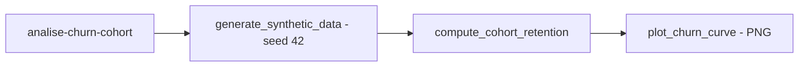

# analise-churn-cohort

[English](README.en.md) · **Português (Brasil)**

[](#) [](#) [](#) [](#) [](LICENSE)

## O que é

**Análise de churn com coortes de retenção**: gera dados sintéticos (usuários + compras, seed fixa), calcula a **retenção por coorte** (período × coorte) e plota a **curva de churn** (matplotlib). É um laboratório educacional de análise de dados para entender retenção de clientes.

## Status

Laboratório educacional de análise, funcional e testado (11 testes).

## Funcionalidades

- **Geração de dados sintéticos determinísticos** (`generate_synthetic_data`, seed fixa 42).
- **Retenção por coorte** (`compute_cohort_retention`): matriz coorte × período.
- **Curva de churn** (`plot_churn_curve`): salva PNG com a evolução da retenção.
- **CLI** `analise-churn-cohort`: `--n-users` (1000), `--n-purchases` (5000), `--output-dir`, `--seed` (42).

## Arquitetura

Pacote `analise_churn_cohort` com `cohort.py` (cálculo/plotagem), `cli.py` (interface) e `__main__.py`. Dados sintéticos → retenção → PNG.



## Stack

- Python ≥ 3.10
- pandas ≥ 2.0, matplotlib ≥ 3.7
- pytest ≥ 9.1 (dev)

## Estrutura do repositório

```
analise-churn-cohort/
├── pyproject.toml · BRIEF.md
├── src/analise_churn_cohort/
│   ├── cohort.py       # retenção por coorte + curva de churn
│   ├── cli.py          # CLI
│   └── __main__.py
├── tests/              # 11 testes
└── LICENSE             # MIT
```

## Pré-requisitos e instalação

Python ≥ 3.10.

```bash
pip install -e .
```

## Como executar

```bash
analise-churn-cohort --n-users 1000 --output-dir saida
# gera dados sintéticos, calcula retenção por coorte e salva saida/churn_curve.png
```

## Testes e qualidade

Comando real (verificado pelo agente):

```bash
PYTHONPATH=src python -m pytest tests/
# 11 passed
```

## Decisões técnicas e trade-offs

- **Dados sintéticos com seed fixa**: reproduzíveis e sem dados reais; em troca, não refletem uma base real.
- **Coorte como método**: padrão de mercado para visualizar retenção; a análise depende da qualidade dos dados.

## Limitações conhecidas e roadmap

- Dados sintéticos — não é uma análise de base real de clientes.
- Saída em gráfico PNG apenas; sem tabela interativa.

## Processo de desenvolvimento

Projeto individual de Kelvin Oliveira, construído com agentes de IA orquestrados e revisado pelo autor. O método de coorte e a revisão são do autor.

## Licença e autor

MIT — Copyright (c) 2026 Kelvin Rebelo de Oliveira.

**Autor**: [Kelvin Oliveira](https://github.com/KelvinOliveiraCode) · [Portfólio](https://kelvinoliveiracode.github.io/portfolio/)
